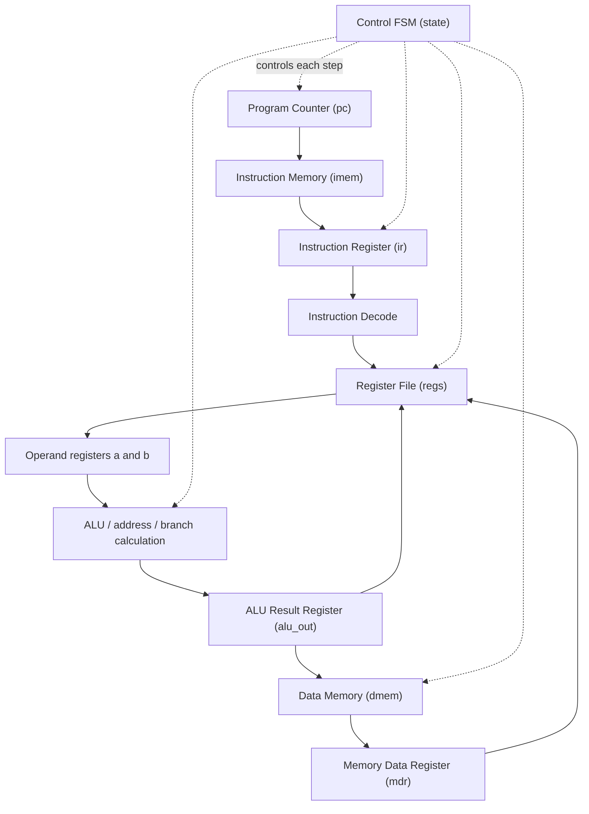
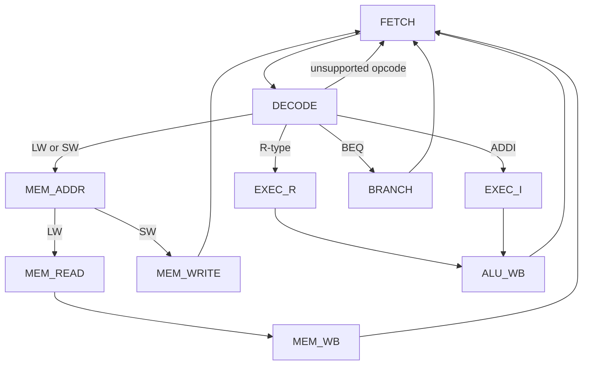
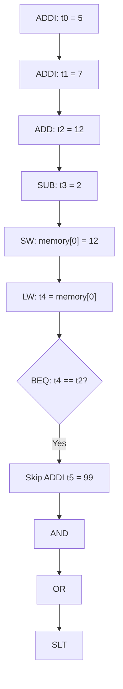
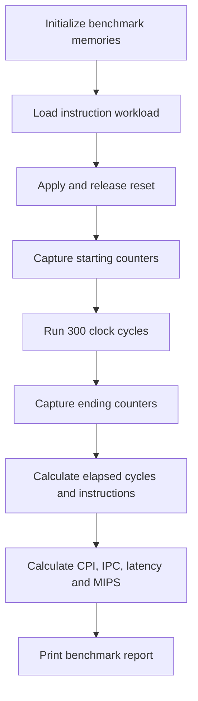

# Lab Project – Multicycle MIPS Processor

## 1. Project overview

This project implements a small **multicycle MIPS-like processor** in Verilog. Rather than completing an instruction in one clock cycle, the processor divides instruction execution into multiple states. A finite-state machine controls the work performed in each state.

The project includes:

- A processor RTL module.
- A functional demonstration testbench.
- A separate performance benchmark testbench.
- VCD waveform generation for both simulations.

### Main objectives

- Understand how a processor executes instructions over multiple clock cycles.
- Implement instruction fetch, decode, execution, memory access and write-back behavior.
- Use an FSM to control the datapath.
- Support a selected subset of MIPS instructions.
- Verify execution by inspecting registers, memory and counters.
- Calculate CPI, IPC, average completion spacing and throughput.

> **Scope:** This is an educational MIPS subset, not a complete implementation of the MIPS ISA. The supported instructions and implementation limits are listed below.

---

## 2. Repository files

| File | Role |
|---|---|
| `multicyclemips.v` | Main processor RTL: state machine, datapath registers, register file and memories. |
| `tb_mips_multicycle.v` | Functional testbench that runs the built-in demonstration program. |
| `benchmark.v` | Benchmark testbench that loads a workload and measures performance over a fixed interval. |
| `mips_multicycle.vcd` | Waveform generated by the functional testbench. |
| `benchmark.vcd` | Waveform generated by the benchmark testbench. |
| `demo.out` | Compiled functional simulation executable. |
| `benchmark.out` | Compiled benchmark simulation executable. |

The two testbenches instantiate the same processor module, but they load/run different programs and have different goals.

---

## 3. Processor architecture

The processor is implemented in the module:

```verilog
module mips_multicycle(input wire clk, input wire reset);
```

It has a clock and an active-high asynchronous reset. The processor's internal state is visible to the testbench through the hierarchical instance `dut`.

### Main components

| Component | RTL identifier | Purpose |
|---|---|---|
| Program counter | `pc` | Holds the address of the next instruction to fetch. |
| Instruction register | `ir` | Holds the currently fetched instruction. |
| Memory data register | `mdr` | Temporarily holds data read from data memory. |
| Register operands | `a`, `b` | Hold values read from the register file. |
| ALU result register | `alu_out` | Stores arithmetic, logical or address/branch calculation results. |
| Register file | `regs[0:31]` | 32 general-purpose 32-bit registers. |
| Instruction memory | `imem[0:63]` | 64 words, each 32 bits wide. |
| Data memory | `dmem[0:63]` | 64 words, each 32 bits wide. |
| Control state | `state` | Selects the current execution step. |
| Cycle counter | `cycle_count` | Counts processor clock cycles after reset. |
| Instruction counter | `instr_count` | Counts completed supported instructions. |

### High-level datapath



This diagram is a conceptual view of the data flow. The RTL implements the operations using registers, arrays, combinational expressions and a clocked `case` statement.

### Why multicycle?

Different instructions require different operations:

- An arithmetic instruction needs instruction fetch, decode, ALU execution and register write-back.
- A load instruction additionally needs a data-memory read and memory-data write-back.
- A store instruction calculates an address and writes a register value to memory.
- A branch calculates a target and compares two register operands.

A multicycle design reuses the same processor resources across these steps. Each FSM state performs a portion of the instruction.

---

## 4. Instruction set implemented

The processor supports the following subset:

| Instruction | Type | Operation |
|---|---|---|
| `ADDI` | I-type | Add a sign-extended immediate to `rs`; write result to `rt`. |
| `ADD` | R-type | Add `rs` and `rt`; write result to `rd`. |
| `SUB` | R-type | Subtract `rt` from `rs`; write result to `rd`. |
| `AND` | R-type | Bitwise AND of `rs` and `rt`; write result to `rd`. |
| `OR` | R-type | Bitwise OR of `rs` and `rt`; write result to `rd`. |
| `SLT` | R-type | Set result to 1 if signed `rs` is less than signed `rt`; otherwise 0. |
| `LW` | I-type | Load a word from data memory into `rt`. |
| `SW` | I-type | Store the value in `rt` to data memory. |
| `BEQ` | I-type | Branch when the values in `rs` and `rt` are equal. |

### Instruction fields

The instruction register is 32 bits. The RTL extracts these fields:

```verilog
wire [5:0] opcode = ir[31:26];
wire [4:0] rs     = ir[25:21];
wire [4:0] rt     = ir[20:16];
wire [4:0] rd     = ir[15:11];
wire [5:0] funct  = ir[5:0];
wire [31:0] imm   = {{16{ir[15]}}, ir[15:0]};
```

| Field | Bits | Meaning |
|---|---|---|
| `opcode` | `[31:26]` | Identifies the instruction class. |
| `rs` | `[25:21]` | First source register. |
| `rt` | `[20:16]` | Second source register or I-type destination. |
| `rd` | `[15:11]` | R-type destination register. |
| `funct` | `[5:0]` | Selects the R-type ALU operation. |
| `imm` | `[15:0]`, extended to 32 bits | Sign-extended immediate or offset. |

The immediate extension is:

```verilog
{{16{ir[15]}}, ir[15:0]}
```

This copies the sign bit `ir[15]` into the upper 16 bits, preserving the signed value of the 16-bit immediate.

### Encodings used by the RTL

| Instruction | Opcode | Function |
|---|---|---|
| R-type | `000000` | Depends on `funct` |
| `ADDI` | `001000` | — |
| `LW` | `100011` | — |
| `SW` | `101011` | — |
| `BEQ` | `000100` | — |
| `ADD` | `000000` | `100000` |
| `SUB` | `000000` | `100010` |
| `AND` | `000000` | `100100` |
| `OR` | `000000` | `100101` |
| `SLT` | `000000` | `101010` |

---

## 5. Multicycle control FSM

The processor uses a 4-bit state register and ten named states.

```verilog
localparam FETCH=0, DECODE=1, MEM_ADDR=2, MEM_READ=3, MEM_WB=4,
           MEM_WRITE=5, EXEC_R=6, EXEC_I=7, ALU_WB=8, BRANCH=9;
```

### State descriptions

| State | Name | Main action |
|---:|---|---|
| 0 | `FETCH` | Read instruction from `imem[pc[7:2]]`, load `ir`, increment PC by 4. |
| 1 | `DECODE` | Read register operands and decode opcode; calculate branch target or memory address where needed. |
| 2 | `MEM_ADDR` | Select the next state: `MEM_READ` for `LW`, otherwise `MEM_WRITE`. |
| 3 | `MEM_READ` | Read data memory into `mdr`. |
| 4 | `MEM_WB` | Write `mdr` into `rt` and count the completed load. |
| 5 | `MEM_WRITE` | Store operand `b` into data memory and count the completed store. |
| 6 | `EXEC_R` | Perform the selected R-type ALU operation. |
| 7 | `EXEC_I` | Perform immediate addition for `ADDI`. |
| 8 | `ALU_WB` | Write the ALU result to `rd` for R-type or `rt` for I-type; count the instruction. |
| 9 | `BRANCH` | Compare `a` and `b`, update PC to the branch target if equal, then count the instruction. |

### FSM flow diagram



Every completed instruction eventually returns to `FETCH`. The number of cycles depends on the instruction path.

### Reset behavior

The processor uses:

```verilog
always @(posedge clk or posedge reset)
```

This means reset is **asynchronous and active-high**. When reset is asserted, the processor does not have to wait for a rising clock edge to enter its reset branch.

The reset branch initializes:

- FSM state to `FETCH`.
- `pc`, `ir`, `mdr`, `a`, `b`, `alu_out` to zero.
- `cycle_count` and `instr_count` to zero.
- All 32 general-purpose registers to zero.

Instruction and data memories are initialized in the module's `initial` block, not cleared by the reset branch.

---

## 6. How instructions execute

### 6.1 Instruction fetch – `FETCH`

```verilog
ir <= imem[pc[7:2]];
pc <= pc + 4;
state <= DECODE;
```

- The instruction at the current PC is read into the instruction register.
- `pc[7:2]` selects a word in the 64-word instruction memory.
- The PC advances by 4 bytes, because each instruction is 32 bits (4 bytes).
- The next state is `DECODE`.

### 6.2 Decode – `DECODE`

```verilog
a <= (rs==0) ? 0 : regs[rs];
b <= (rt==0) ? 0 : regs[rt];
```

The source operands are read into temporary registers `a` and `b`. Register zero is treated as zero.

The opcode determines the next execution path:

| Opcode | Next state |
|---|---|
| `LW` or `SW` | `MEM_ADDR` |
| `BEQ` | `BRANCH` |
| R-type | `EXEC_R` |
| `ADDI` | `EXEC_I` |
| Other | `FETCH` |

For memory instructions, the effective address is calculated:

```verilog
alu_out <= ((rs==0) ? 0 : regs[rs]) + imm;
```

For `BEQ`, the branch target is calculated:

```verilog
alu_out <= pc + (imm << 2);
```

Because the PC was already advanced during fetch, this expression uses the incremented PC plus the sign-extended offset shifted left by two bits.

### 6.3 Load and store address path – `MEM_ADDR`

The FSM chooses the memory operation:

```verilog
state <= (opcode==6'b100011) ? MEM_READ : MEM_WRITE;
```

- `LW` goes to `MEM_READ`.
- `SW` goes to `MEM_WRITE`.

### 6.4 Load – `MEM_READ` and `MEM_WB`

```verilog
mdr <= dmem[alu_out[7:2]];
```

The selected data-memory word is read into `mdr`.

Then:

```verilog
if (rt != 0)
    regs[rt] <= mdr;
instr_count <= instr_count + 1;
state <= FETCH;
```

The loaded word is written into destination register `rt`, unless `rt` is register zero. The instruction counter increments and the processor returns to fetch.

### 6.5 Store – `MEM_WRITE`

```verilog
dmem[alu_out[7:2]] <= b;
instr_count <= instr_count + 1;
state <= FETCH;
```

The value held in operand register `b` is stored at the calculated data-memory word index. The instruction counter increments.

### 6.6 R-type arithmetic and logic – `EXEC_R`

The `funct` field selects the operation:

| Function | Operation | RTL behavior |
|---|---|---|
| `6'h20` | ADD | `alu_out <= a + b` |
| `6'h22` | SUB | `alu_out <= a - b` |
| `6'h24` | AND | `alu_out <= a & b` |
| `6'h25` | OR | `alu_out <= a \| b` |
| `6'h2A` | SLT | Signed comparison; result is 1 or 0 |

After execution, the FSM moves to `ALU_WB`.

### 6.7 Immediate arithmetic – `EXEC_I`

For `ADDI`:

```verilog
alu_out <= a + imm;
state <= ALU_WB;
```

The sign-extended immediate is added to operand `a`.

### 6.8 ALU write-back – `ALU_WB`

The destination register depends on the instruction type:

- R-type writes to `rd`.
- I-type `ADDI` writes to `rt`.

```verilog
if (opcode==6'b000000) begin
    if (rd != 0)
        regs[rd] <= alu_out;
end else begin
    if (rt != 0)
        regs[rt] <= alu_out;
end
instr_count <= instr_count + 1;
state <= FETCH;
```

Register zero is protected from writes.

### 6.9 Branch – `BRANCH`

```verilog
if (a == b)
    pc <= alu_out;
instr_count <= instr_count + 1;
state <= FETCH;
```

- If `a` and `b` are equal, the PC is replaced with the previously calculated branch target.
- If they are not equal, the PC remains at the sequential address.
- The branch instruction is counted as completed in either case.

---

## 7. Memory and register organization

### Register file

```verilog
reg [31:0] regs [0:31];
```

- 32 registers.
- Each register is 32 bits wide.
- `regs[0]` is maintained as zero.
- R-type instructions write to `rd`.
- `ADDI` and `LW` write to `rt`.

The RTL enforces register zero by setting `regs[0] <= 0` on every normal clock cycle and by checking that a destination register is not zero before writing.

### Instruction memory

```verilog
reg [31:0] imem [0:63];
```

Contains 64 instructions (64 words). The fetch address is:

```verilog
imem[pc[7:2]]
```

The PC advances by four for each sequential instruction. The index uses address bits `[7:2]`, selecting a word rather than a byte.

### Data memory

```verilog
reg [31:0] dmem [0:63];
```

Contains 64 words. The word index is:

```verilog
dmem[alu_out[7:2]]
```

The lower two address bits are ignored, consistent with word-aligned 32-bit accesses in this simplified design.

---

## 8. Functional demonstration program

The processor initializes its instruction memory in the `initial` block of `multicyclemips.v`.

| Index | Machine code | Instruction | Purpose |
|---:|---|---|---|
| 0 | `20080005` | `addi $t0, $zero, 5` | Set register 8 to 5. |
| 1 | `20090007` | `addi $t1, $zero, 7` | Set register 9 to 7. |
| 2 | `01095020` | `add $t2, $t0, $t1` | Add 5 and 7; result 12. |
| 3 | `01285822` | `sub $t3, $t1, $t0` | Subtract 5 from 7; result 2. |
| 4 | `AC0A0000` | `sw $t2, 0($zero)` | Store 12 at data-memory address 0. |
| 5 | `8C0C0000` | `lw $t4, 0($zero)` | Load the value at address 0 into register 12. |
| 6 | `118A0001` | `beq $t4, $t2, 1` | Branch because both values are 12. |
| 7 | `200D0063` | `addi $t5, $zero, 99` | Skipped by the taken branch. |
| 8 | `01097024` | `and $t6, $t0, $t1` | Bitwise AND. |
| 9 | `01097825` | `or $t7, $t0, $t1` | Bitwise OR. |
| 10 | `0109802A` | `slt $s0, $t0, $t1` | Signed comparison: 5 < 7. |

### Program flow



The branch is taken because the load places 12 in `$t4`, and `$t2` also contains 12. The branch skips instruction index 7. Therefore, the program completes 10 instructions.

### Expected final register/memory values

Register names use conventional MIPS aliases:

| Register | Index | Expected value | Reason |
|---|---:|---:|---|
| `$t0` | 8 | 5 | First `ADDI`. |
| `$t1` | 9 | 7 | Second `ADDI`. |
| `$t2` | 10 | 12 | `5 + 7`. |
| `$t3` | 11 | 2 | `7 - 5`. |
| `$t4` | 12 | 12 | Loaded from `dmem[0]`. |
| `$t5` | 13 | 0 | Its `ADDI` instruction is skipped. |
| `$t6` | 14 | 5 | `5 AND 7`. |
| `$t7` | 15 | 7 | `5 OR 7`. |
| `$s0` | 16 | 1 | Signed comparison `5 < 7`. |

Expected data memory:

| Location | Expected value |
|---|---:|
| `dmem[0]` | 12 |

The functional testbench prints nonzero registers, `dmem[0]`, completed instructions and clock cycles. The exact cycle count follows the implemented state paths.

---

## 9. Functional testbench

### File: `tb_mips_multicycle.v`

The functional testbench instantiates the processor:

```verilog
mips_multicycle dut(.clk(clk), .reset(reset));
```

It generates a 10 ns clock:

```verilog
always #5 clk = ~clk;
```

This corresponds to a 100 MHz simulation clock.

### Testbench sequence

1. Start with `reset = 1`.
2. Wait for two rising clock edges.
3. Deassert reset after a small delay.
4. Wait until `dut.instr_count == 10`.
5. Wait for a rising edge and a short delay so the final values can settle.
6. Print all nonzero registers.
7. Print `dmem[0]`, instruction count and cycle count.
8. Finish the simulation.

The testbench also has a timeout:

```verilog
#2000;
$display("ERROR: timeout waiting for program completion");
$finish;
```

If the program does not reach 10 completed instructions within the timeout, the testbench prints an error message.

### Why does the testbench use `dut`?

`dut` means **device under test**. It is the instance name of the processor module. Hierarchical references such as `dut.regs[i]` allow the testbench to inspect internal registers and memory for verification. These references are testbench access, not external ports of the processor module.

---

## 10. Performance benchmark

### File: `benchmark.v`

The benchmark instantiates the same `mips_multicycle` module, but it replaces the instruction memory contents with a custom workload.

It includes:

- Immediate arithmetic.
- Store and load.
- Addition and subtraction.
- AND and OR.
- Set-less-than.
- A conditional branch.
- A repeated ADD instruction stream to fill the remaining instruction-memory entries.

The benchmark runs for a fixed measurement interval of **300 clock cycles** after establishing a counter baseline.

### Benchmark clock

```verilog
always #5 clk = ~clk;
```

The clock period is 10 ns:

\[
T = 10\text{ ns}
\]

The clock frequency is:

\[
f = \frac{1}{T} = 100\text{ MHz}
\]

### Measurement procedure

The testbench:

1. Clears the instruction and data memories.
2. Loads the benchmark instruction sequence.
3. Releases reset after two clock edges.
4. Establishes starting cycle and instruction counter values.
5. Runs for 300 rising clock edges.
6. Captures ending counter values.
7. Calculates elapsed cycles and completed instructions.
8. Computes the performance metrics.



### Performance formulas

Let:

- \(C\) = elapsed measurement cycles.
- \(I\) = completed instructions.
- \(T\) = clock period.
- \(f\) = clock frequency.

#### 1. Cycles per instruction (CPI)

CPI is the average number of clock cycles used per completed instruction.

\[
\boxed{CPI = \frac{C}{I}}
\]

A lower CPI means fewer cycles are used per instruction on average.

#### 2. Instructions per cycle (IPC)

IPC is the average number of completed instructions per cycle.

\[
\boxed{IPC = \frac{I}{C}}
\]

For this measurement, CPI and IPC are reciprocals when both counts are nonzero.

#### 3. Average completion spacing

The benchmark estimates average time per completed instruction using:

\[
\boxed{\text{Average completion spacing} = CPI \times T}
\]

With a 10 ns clock period:

\[
\text{Average completion spacing} = CPI \times 10\text{ ns}
\]

This is an average throughput-related spacing, not the latency of every individual instruction.

#### 4. Throughput in MIPS

MIPS means millions of instructions per second. With frequency expressed in MHz:

\[
\boxed{\text{MIPS} = IPC \times f_{\text{MHz}}}
\]

For this 100 MHz clock:

\[
\text{MIPS} = IPC \times 100
\]

### Benchmark output fields

| Field | Meaning |
|---|---|
| Clock frequency | Simulated clock frequency (100 MHz). |
| Measurement cycles | Difference between ending and starting cycle counters. |
| Instructions completed | Difference between ending and starting instruction counters. |
| CPI | Average cycles per completed instruction. |
| IPC | Average completed instructions per cycle. |
| Average completion latency | CPI multiplied by the 10 ns clock period. |
| Throughput | IPC multiplied by 100 MHz, expressed in MIPS. |

**Important:** This is a custom, SPEC-inspired educational workload. It is not an official SPEC CPU benchmark and does not generate official SPEC scores. Its results characterize this RTL model and this particular workload only.

---

## 11. Compile and run

Install Icarus Verilog before running the commands.

### A. Run the functional demonstration

From the `DLCD_Lab_Project` directory:

```bash
iverilog -g2012 -o demo.out multicyclemips.v tb_mips_multicycle.v
vvp demo.out
```

This compiles the processor and functional testbench, then runs the demonstration program. It generates `mips_multicycle.vcd`.

### B. Run the performance benchmark

```bash
iverilog -g2012 -o benchmark.out multicyclemips.v benchmark.v
vvp benchmark.out
```

This compiles the processor with the benchmark testbench, runs the fixed measurement interval and generates `benchmark.vcd`.

### C. View functional waveform

```bash
gtkwave mips_multicycle.vcd
```

### D. View benchmark waveform

```bash
gtkwave benchmark.vcd
```

### Suggested GTKWave signals

| Signal | What to observe |
|---|---|
| `clk` | Clock edges and timing. |
| `reset` | Reset assertion and release. |
| `dut.state` | Current multicycle FSM state. |
| `dut.pc` | Instruction address progression and branch redirection. |
| `dut.ir` | Currently executing instruction. |
| `dut.a`, `dut.b` | Source operands captured during decode. |
| `dut.alu_out` | Arithmetic result, memory address or branch target. |
| `dut.mdr` | Data read from data memory. |
| `dut.regs` | Register-file contents. |
| `dut.dmem` | Data-memory contents. |
| `dut.cycle_count` | Number of cycles since reset. |
| `dut.instr_count` | Number of completed instructions. |

The most useful signals for understanding instruction execution are `state`, `pc`, `ir`, `alu_out`, `regs`, `dmem` and the two counters.

---

## 12. Important implementation details and limitations

1. **Instruction subset:** Only `ADDI`, `ADD`, `SUB`, `AND`, `OR`, `SLT`, `LW`, `SW` and `BEQ` are implemented.
2. **Memory capacity:** Instruction and data memories each contain 64 32-bit words.
3. **Word addressing:** The RTL indexes memories with address bits `[7:2]`. This is a simplified word-aligned memory model.
4. **Register zero:** Register 0 is forced to zero during normal execution, and writes to destination register 0 are suppressed.
5. **Reset:** The processor reset is asynchronous and active-high. This differs from the traffic-light project's synchronous reset.
6. **Memory initialization:** Memories are initialized in an `initial` block. The processor reset does not clear data memory or reload the instruction program.
7. **Unsupported opcodes:** The decode default returns to `FETCH`; unsupported instructions are not fully handled as architectural exceptions.
8. **No complete MIPS system:** The project does not implement the full MIPS ISA, operating system, cache hierarchy, pipeline, interrupts or a complete memory system.
9. **Counter width:** Both counters are 32-bit registers and wrap around after \(2^{32}\) increments.
10. **Benchmark scope:** The benchmark uses a fixed 300-cycle window and a repeated instruction stream. Its performance figures depend on this implementation and workload.

---

## 13. Key concepts to remember

- **Multicycle processor:** Executes an instruction over multiple clock cycles, with different work performed in different control states.
- **Program counter (PC):** Holds the address used to fetch the next instruction.
- **Instruction register (IR):** Holds the instruction currently being decoded/executed.
- **Register file:** Stores operands and results for instructions.
- **ALU:** Performs arithmetic, logical and comparison operations.
- **FSM controller:** Selects the processor operation for each cycle.
- **Load (`LW`):** Reads data memory and writes the value into a register.
- **Store (`SW`):** Writes a register value into data memory.
- **Branch (`BEQ`):** Changes the PC when two register operands are equal.
- **CPI:** Average cycles per completed instruction.
- **IPC:** Average completed instructions per cycle.
- **Throughput:** Rate at which instructions are completed.

---

## 14. Quick reference

### FSM state sequence by instruction

| Instruction | State path |
|---|---|
| R-type (`ADD`, `SUB`, `AND`, `OR`, `SLT`) | `FETCH → DECODE → EXEC_R → ALU_WB → FETCH` |
| `ADDI` | `FETCH → DECODE → EXEC_I → ALU_WB → FETCH` |
| `LW` | `FETCH → DECODE → MEM_ADDR → MEM_READ → MEM_WB → FETCH` |
| `SW` | `FETCH → DECODE → MEM_ADDR → MEM_WRITE → FETCH` |
| `BEQ` | `FETCH → DECODE → BRANCH → FETCH` |

### Run commands

```bash
# Functional demonstration
iverilog -g2012 -o demo.out multicyclemips.v tb_mips_multicycle.v
vvp demo.out

# Performance benchmark
iverilog -g2012 -o benchmark.out multicyclemips.v benchmark.v
vvp benchmark.out

# Open waveforms
gtkwave mips_multicycle.vcd
gtkwave benchmark.vcd
```

---

## 15. Project summary

| Feature | Implementation |
|---|---|
| Processor style | Multicycle |
| Data width | 32 bits |
| Register file | 32 × 32-bit registers |
| Instruction memory | 64 × 32-bit words |
| Data memory | 64 × 32-bit words |
| Control | 10-state FSM |
| Supported instructions | 9 instruction operations |
| Reset | Asynchronous, active-high |
| Functional verification | Demonstration program and register/memory inspection |
| Performance verification | Fixed-window benchmark |
| Metrics | CPI, IPC, average completion spacing and MIPS |
| Simulation tools | Icarus Verilog; GTKWave optional |
