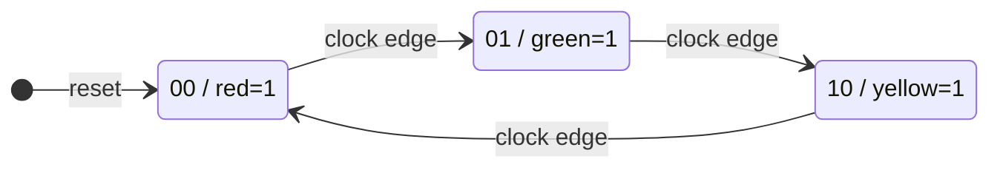
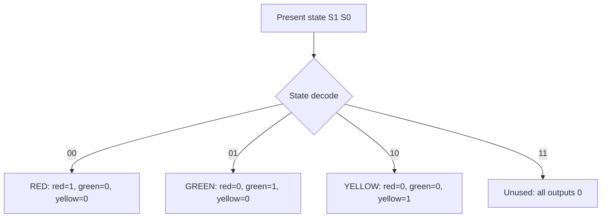
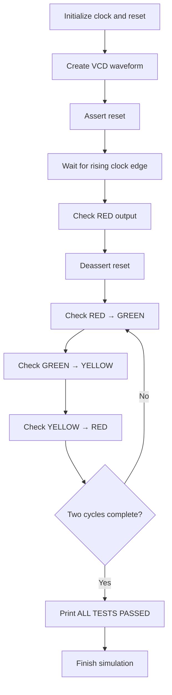

# Theory Mini-Project – K-map-Based Traffic Light Controller

## 1. Project overview

This project designs a three-state traffic light controller using a **finite-state machine (FSM)**. The controller continuously follows this sequence:

**RED → GREEN → YELLOW → RED → ...**

The important design requirement is that the next-state logic must be obtained through **Karnaugh-map (K-map) minimization** and implemented using the resulting Boolean equations. The RTL therefore uses explicit next-state equations rather than a behavioral `case` statement for the state transitions.

### Objectives

- Represent the three traffic-light phases using a 2-bit state register.
- Construct the state-transition truth table.
- Treat the unused state as a don't-care during minimization.
- Derive the D-input equations using K-maps.
- Implement the Moore outputs as Boolean equations.
- Verify the state sequence with a Verilog testbench.
- Inspect the simulation through a VCD waveform.

---

## 2. Requirements and specifications

| Item | Specification |
|---|---|
| Clock | `clk` |
| Reset | `reset`, synchronous and active-high |
| State storage | 2-bit register |
| State sequence | RED → GREEN → YELLOW → RED |
| Outputs | `red`, `green`, `yellow` |
| Output type | One-hot in each valid state |
| Unused encoding | `11`, treated as a don't-care during K-map minimization |
| State update | Rising edge of `clk` |

A reset is **synchronous**: it is sampled only on a rising edge of the clock. When `reset = 1` at that edge, the state becomes RED (`00`).

## 3. State encoding

Two flip-flops are sufficient to represent three states.

Let the state bits be `S1 S0`:

| State | `S1 S0` | `red green yellow` |
|---|---:|---:|
| RED | `00` | `100` |
| GREEN | `01` | `010` |
| YELLOW | `10` | `001` |
| Unused | `11` | `000` |

The output vector is one-hot for every valid state: exactly one output is high. For the unused encoding, all three output equations evaluate to zero.

### State transition diagram



The state changes once per active rising clock edge when reset is not asserted.

---

## 4. State-transition truth table

The two state bits are the present state. The D inputs are the values that will be loaded into the state flip-flops at the next rising edge.

| Present `S1` | Present `S0` | Present state | Next state | `D1` | `D0` |
|---:|---:|---|---|---:|---:|
| 0 | 0 | RED | GREEN (`01`) | 0 | 1 |
| 0 | 1 | GREEN | YELLOW (`10`) | 1 | 0 |
| 1 | 0 | YELLOW | RED (`00`) | 0 | 0 |
| 1 | 1 | Unused | Don't-care | X | X |

Therefore:

- `D1` is 1 only for present state `01`.
- `D0` is 1 only for present state `00`.
- Present state `11` is marked `X` for the K-map minimization.

---

## 5. Karnaugh-map minimization

A two-variable K-map is used. Rows represent `S1`; columns represent `S0`. With two variables, the column order is `0, 1`.

### 5.1 Deriving `D1`

From the transition table:

| `S1 \ S0` | 0 | 1 |
|---|---:|---:|
| 0 | 0 | 1 |
| 1 | 0 | X |

The 1 at `(S1,S0) = (0,1)` can be grouped with the adjacent don't-care at `(1,1)`.

```text
             S0
             0   1
          +---+---+
     S1=0 | 0 | 1 |
          +---+---+
     S1=1 | 0 | X |
          +---+---+
                └── vertical pair
```

Across this pair, `S1` changes from 0 to 1, while `S0` remains 1. The changing variable is eliminated.

**Minimized equation:**

\[
\boxed{D_1 = S_0}
\]

### 5.2 Deriving `D0`

From the transition table:

| `S1 \ S0` | 0 | 1 |
|---|---:|---:|
| 0 | 1 | 0 |
| 1 | 0 | X |

The 1 at `00` is not adjacent to the don't-care at `11` in a two-variable Gray-code K-map. It therefore remains a single-cell group.

```text
             S0
             0   1
          +---+---+
     S1=0 | 1 | 0 |
          +---+---+
     S1=1 | 0 | X |
          +---+---+
          single-cell group
```

The minterm for `00` requires both state bits to be complemented.

**Minimized equation:**

\[
\boxed{D_0 = \overline{S_1}\,\overline{S_0}}
\]

Equivalent Verilog expression:

```verilog
~S1 & ~S0
```

### 5.3 Final next-state equations

| Flip-flop input | Minimized equation |
|---|---|
| `D1` | `S0` |
| `D0` | `~S1 & ~S0` |

The equations produce the required transitions for all three valid states:

| Present state | `D1 D0` | Next state |
|---|---|---|
| `00` RED | `01` | GREEN |
| `01` GREEN | `10` | YELLOW |
| `10` YELLOW | `00` | RED |
| `11` unused | `10` | YELLOW |

The final row is a consequence of the selected minimized equations. The specification marks `11` as a don't-care, so its behavior is not required for the valid-state sequence.

---

## 6. Moore output equations

This is a **Moore FSM** because each output depends only on the present state, not directly on the clock or an input.

Each traffic-light output is active in exactly one valid state.

| State | `S1 S0` | Output asserted | Boolean equation |
|---|---|---|---|
| RED | `00` | `red` | `~S1 & ~S0` |
| GREEN | `01` | `green` | `~S1 & S0` |
| YELLOW | `10` | `yellow` | `S1 & ~S0` |
| Unused | `11` | None | All equations evaluate to 0 |

Thus:

\[
\boxed{red = \overline{S_1}\,\overline{S_0}}
\]

\[
\boxed{green = \overline{S_1}\,S_0}
\]

\[
\boxed{yellow = S_1\,\overline{S_0}}
\]

### Output decoding



The three output equations are mutually exclusive: no two outputs are high at the same time.

---

## 7. Verilog implementation

### File: `traffic_light_fsm.v`

The module contains:

1. Clock and reset inputs.
2. Three output wires.
3. A 2-bit state register.
4. Wires for the present-state bits.
5. The K-map-derived D equations.
6. The sequential state update.
7. The Moore output equations.

```verilog
`timescale 1ns/1ps

module traffic_light_fsm (
    input  wire clk,
    input  wire reset,
    output wire red,
    output wire green,
    output wire yellow
);
    reg [1:0] state;
    wire S1 = state[1];
    wire S0 = state[0];

    wire D1 = S0;
    wire D0 = ~S1 & ~S0;

    always @(posedge clk) begin
        if (reset)
            state <= 2'b00;
        else
            state <= {D1, D0};
    end

    assign red    = ~S1 & ~S0;
    assign green  = ~S1 &  S0;
    assign yellow =  S1 & ~S0;
endmodule
```

### Understanding the important statements

| Code | Purpose |
|---|---|
| `reg [1:0] state;` | Stores the current state in two bits. |
| `wire S1 = state[1];` | Names the most significant state bit. |
| `wire S0 = state[0];` | Names the least significant state bit. |
| `wire D1 = S0;` | Implements the minimized `D1` equation. |
| `wire D0 = ~S1 & ~S0;` | Implements the minimized `D0` equation. |
| `always @(posedge clk)` | Updates the state on a rising clock edge. |
| `if (reset)` | Gives reset priority over the normal transition. |
| `state <= 2'b00;` | Resets the controller to RED. |
| `state <= {D1, D0};` | Loads the next-state bits into the state register. |
| `assign ...` | Continuously decodes the Moore outputs from the state. |

**Why use nonblocking assignment (`<=`)?** The state register is sequential logic. Nonblocking assignments model flip-flop updates correctly: the new state is scheduled for the end of the current simulation time step.

**Why is there no `case` statement?** The next-state logic is explicitly implemented from the K-map-derived equations, as required by the project specification.

---

## 8. Testbench and verification

### File: `tb_traffic_light_fsm.v`

The testbench verifies that the design:

- Responds to a synchronous reset by entering RED.
- Advances from RED to GREEN.
- Advances from GREEN to YELLOW.
- Advances from YELLOW back to RED.
- Repeats the complete sequence twice.
- Produces the correct one-hot output vector in every checked state.

### Testbench structure



### Clock generation

```verilog
always #5 clk = ~clk;
```

The clock toggles every 5 ns, producing a 10 ns period.

\[
T = 10\text{ ns}, \qquad f = \frac{1}{T} = 100\text{ MHz}
\]

### Output checking

The testbench uses a task named `check_output`. It compares the actual output vector against the expected vector.

```verilog
if ({red,green,yellow} !==
    {expected_red,expected_green,expected_yellow}) begin
    $display("FAIL ...");
    $fatal(1);
end
```

The `!==` operator is case inequality. It detects mismatches including unknown (`X`) and high-impedance (`Z`) values. `$fatal(1)` stops the simulation when a check fails.

A successful check prints a `PASS` message.

### Expected output sequence

| Check | Expected `red green yellow` |
|---|---:|
| Reset → RED | `100` |
| RED | `100` |
| GREEN | `010` |
| YELLOW | `001` |
| RED | `100` |
| GREEN | `010` |
| YELLOW | `001` |
| RED | `100` |

The testbench checks the reset state and two complete RED–GREEN–YELLOW cycles.

---

## 9. Compile and run

Run these commands from the `DLCD_Theory_Project` directory.

### Compile and run the testbench

```bash
iverilog -g2012 -Wall -s tb_traffic_light_fsm -o traffic_light_sim traffic_light_fsm.v tb_traffic_light_fsm.v
vvp traffic_light_sim
```

- `iverilog` compiles the Verilog source.
- `-g2012` enables SystemVerilog 2012 language support.
- `-Wall` enables compiler warnings.
- `-s tb_traffic_light_fsm` selects the testbench as the top-level module.
- `-o traffic_light_sim` names the compiled simulation executable.
- `vvp` runs the compiled simulation.

Expected final message:

```text
ALL TESTS PASSED: two complete traffic-light cycles.
```

### Compile only the design

```bash
iverilog -g2012 -Wall -s traffic_light_fsm -o traffic_light_design traffic_light_fsm.v
```

This compiles the controller without the testbench. It does not run a simulation by itself.

### View the waveform

```bash
gtkwave traffic_light.vcd
```

Useful signals:

- `clk` – clock signal.
- `reset` – synchronous reset input.
- `dut.state` – internal 2-bit state register.
- `red`, `green`, `yellow` – decoded outputs.

In GTKWave, observe that the state changes only at rising clock edges and follows `00 → 01 → 10 → 00`.

---

## 10. Design summary

| Feature | Implementation |
|---|---|
| FSM type | Moore |
| Number of valid states | 3 |
| State register width | 2 bits |
| State encoding | RED=`00`, GREEN=`01`, YELLOW=`10` |
| Unused encoding | `11` |
| Reset | Synchronous, active-high |
| State transition logic | K-map-derived Boolean equations |
| `D1` | `S0` |
| `D0` | `~S1 & ~S0` |
| Output logic | Three state-decoding equations |
| Verification | Testbench checks reset and two complete cycles |

## 11. Key concepts to remember

- A **state register** stores the present state of a sequential circuit.
- The **next state** is the state loaded at the next active clock edge.
- A **K-map** simplifies Boolean expressions by grouping adjacent 1s, optionally using don't-care cells.
- A **don't-care** is an input combination whose output is not constrained by the specification; it may be used to simplify logic.
- A **Moore machine** produces outputs based only on its present state.
- A **synchronous reset** takes effect only at the active clock edge.
- A **testbench** applies inputs and checks whether the design produces the expected outputs.

---

## 12. Project files

| File | Description |
|---|---|
| `traffic_light_fsm.v` | Traffic-light FSM RTL design. |
| `tb_traffic_light_fsm.v` | Testbench for reset and state-sequence verification. |
| `traffic_light.vcd` | Recorded simulation waveform. |
| `traffic_light_sim` | Compiled Icarus Verilog simulation executable. |
| `traffic_light_design` | Optional design-only compilation output; generated by the design-only command. |
| `DLCD_Mini-Project-Theory_Section_I-Team_5.pdf` | Original theory project report. |
